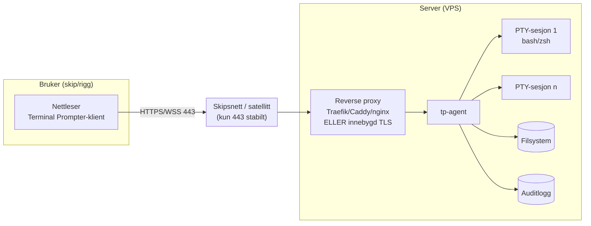
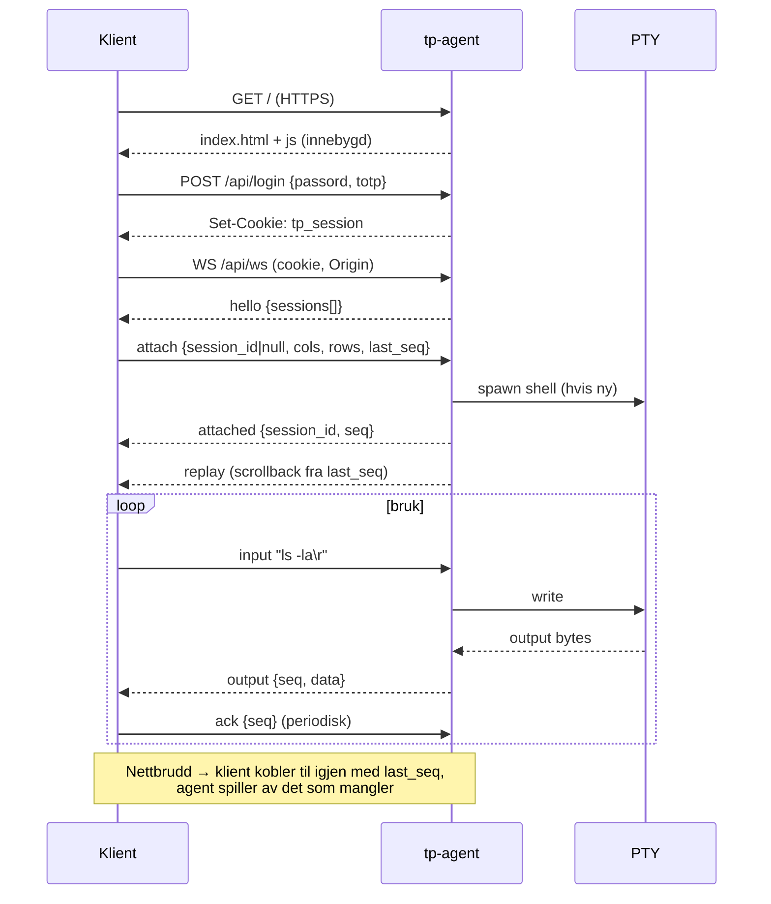

# 01 – Systemarkitektur

## Komponentoversikt

## Komponenter

| Komponent | Ansvar | Teknologi |
|---|---|---|
| **tp-agent** | HTTP-server, auth, WS/SSE-transport, PTY-sesjoner, filoverføring, auditlogg, serverer klienten | Dart (AOT, `dart compile exe`), én binær |
| **Nettklient** | Terminalvisning, Prompter-felt, gjenoppkobling, filopplasting, innstillinger | HTML/JS, xterm.js |
| **Bootstrap-side** | Keymap-kalibrering, generering av tegnsikre installasjonskommandoer | Statisk side (hostes på produktdomene + finnes offline i klienten) |
| **Installasjonsskript** | Laster ned riktig binær, oppretter bruker/tjeneste, setter passord, valgfritt TLS | POSIX sh |
| **Relay (v2)** | Mellomledd så agenten kan ringe ut; flåtestyring; betaling | Dart + Postgres, EU-hostet |

## Driftsmodi for agenten

| Modus | Lytter på | TLS | Bruk |
|---|---|---|---|
| `proxy` (standard) | `127.0.0.1:7681` | Håndteres av eksisterende reverse proxy | Servere med Coolify/Traefik, nginx, Caddy |
| `standalone` | `0.0.0.0:443` | Sertifikatfiler (`SecurityContext`); installer anbefaler heller Caddy foran | Servere uten webserver der Caddy ikke ønskes |
| `relay` (v2) | Ingen inngående | Utgående WSS til relay | Servere bak NAT/brannmur, flåter |

## Hovedflyt: bruke terminalen

## Prinsipper

1. **Sesjonen bor på serveren, ikke i forbindelsen.** En PTY lever videre når klienten forsvinner (konfigurerbar levetid, standard 24 t). Klienten er en «visning» som kan festes og løsnes.
2. **All output nummereres.** Hver output-frame har et monotont `seq`. Agenten holder en ringbuffer (standard 1 MB per sesjon). Gjenoppkobling = «send alt etter seq X».
3. **Klienten eier redigeringen.** I Prompter-modus skrives hele kommandoen lokalt (null latens) og sendes som én enhet. I Raw-modus går tastetrykk direkte (for vim, htop osv.).
4. **Transportuavhengig kjerne.** Sesjonslogikken vet ikke om den snakker med WS eller SSE. Begge implementerer samme `Transport`-grensesnitt.
5. **Én binær, null avhengigheter.** Installasjon skal fungere på en minimal Debian/Ubuntu/Alma uten pakkeinstallasjon.
6. **Feil sikkert.** Uten gyldig konfig/passord starter agenten ikke. Lytter aldri på offentlig port uten TLS.

## Ikke-funksjonelle krav

| Krav | Mål |
|---|---|
| Binærstørrelse | < 15 MB |
| Minne (tomgang / per sesjon) | < 20 MB / < 5 MB + ringbuffer |
| Klientstørrelse (gzip) | < 450 KB inkl. xterm.js og dart2js-output |
| Gjenoppkobling etter brudd | < 3 s etter at nett er tilbake |
| Tåle | 800 ms RTT, 10 % pakketap, 64 kbit/s |
| Installasjon | < 60 s fra kommando til innlogging |
| Mobil | Alle funksjoner brukbare på telefon med én hånd (iOS Safari, Android Chrome, siste 2 versjoner); tastelinje lukker aldri telefonens tastatur |
| Plattform | Linux x64/arm64 med glibc (Alpine via gcompat), `setsid` (util-linux/BusyBox), systemd valgfritt |
