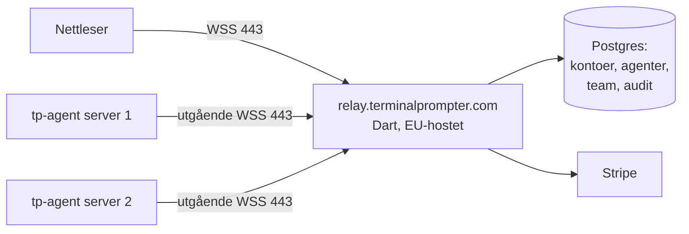

# 09 – SaaS, relay og inntekt

## Hvorfor relay er der pengene ligger

Selvhostet agent (v1) er lett å kopiere med gratisverktøy (ttyd + Caddy). Det folk og bedrifter betaler for, er det de **ikke** enkelt kan sette opp selv:

1. Ingen inngående porter/domener/sertifikater på serveren.
2. Én innlogging for mange servere (flåte).
3. Team, roller, revisjon, SSO – det maritim IT krever.

> **Oppdatert:** Relay for privatbrukere er flyttet til **v1.5** og bruker TLS-gjennomstrømming, så relay ikke kan lese trafikken. Detaljert design, sertifikatflyt, linking, reisepass og prising står i **doc 17** og har forrang. Seksjonen under beskriver v2-utvidelsene (multipleksing av klientsesjoner, flåte, team).

## Relay-arkitektur (v2)

- Agenten registreres med engangskode: `tp-agent link ABCD-1234` (tegnsikker!). Får langlevd agent-nøkkel (ed25519-nøkkelpar generert lokalt, kun offentlig nøkkel til relay).
- Agenten holder én utgående WSS mot relay med samme heartbeat-/gjenopptakslogikk som klienten.
- Relay multiplekser: én agent-forbindelse bærer mange klientsesjoner (`channel_id` legges til i protokollen; ellers identisk med v1).
- **Ende-til-ende-kryptering (v2.1):** klient og agent gjør X25519-nøkkelutveksling gjennom relay; relay ser kun kryptert trafikk. Viktig salgsargument mot sikkerhetsbevisste rederier. Konsekvens: relay kan ikke logge kommandoer – auditlogg skjer i agenten og lastes opp kryptert eller kun metadata.
- Hosting i EU (f.eks. Hetzner Helsinki/Falkenstein) – GDPR og personvern som prinsipp.
- Relay skrives i Dart (gjenbruker `tp_protocol`, transportkode og `tp_netsim`). Postgres via `package:postgres`.

## Flerserverkjøring (v2.0)

Samme kommando på mange servere, med jobben eid av relay så den fullføres selv om skipsnettet faller ut. Full spesifikasjon i doc 15.

## Produktnivåer og prising

| Nivå | Pris | Innhold | Formål |
|---|---|---|---|
| **Open/Self-host** | Gratis | Agent, én server, direkte modus | Trakt, omdømme, GitHub-stjerner |
| **Reisepass** (v1.5) | USD 9 for 30 dager | Relay for inntil 3 servere, uten abonnement | Cruise, reiser, korte oppdrag |
| **Personal** (v1.5) | USD 9/mnd eller 90/år | Relay, opptil 5 servere, passkey, reservekoder, synk av egne knapper | Enkeltdriftere offshore |
| **Founder** (før v1.5) | USD 99 engangs = 3 år Personal | Selges på venteliste | Teste etterspørsel |
| **Pro** | USD 19/mnd per bruker | Ubegrenset servere, flerserverkjøring (inntil 10 mål per jobb), snuttbibliotek synk, filoverføring via relay, E2E | Konsulenter, MSP-er |
| **Fleet (bedrift)** | USD 29/bruker/mnd, min. 10 brukere, eller årsavtale | Ubegrenset flerserverkjøring, SSO, roller, godkjenningsflyt for farlige kommandoer, sentral auditeksport, SLA | Rederier, subsea-selskaper, riggoperatører |
| **On-prem relay-lisens** | Engangs USD 3–10k + 20 %/år vedlikehold | Relay i kundens eget datasenter | Kunder som ikke kan bruke sky |

## Inntektsregnestykke (illustrativt, ikke prognose)

| Scenario år 2 | Kunder | MRR (USD) |
|---|---|---|
| Kun personlige | 150 Personal + 40 Pro | 1 350 + 760 ≈ 2 100 |
| + 3 Fleet-kunder à 15 brukere | 45 seter | + 1 305 ≈ 3 400 |
| + 1 on-prem lisens | – | + engangs ~5 000 |

Fleet-kundene er det som gjør dette til en virksomhet. Én avtale med et subsea-selskap kan være verdt mer enn 100 enkeltbrukere. Egen bransjebakgrunn og nettverk (DeepOcean, Personalhuset, BSA Offshore) er den mest realistiske salgskanalen – pilot hos én aktør først.

## Lisensmodell for kode

- Agent + klient + protokoll: åpen kildekode (Apache-2.0) → tillit (folk installerer noe med root-tilgang) og spredning.
- Relay + Fleet-funksjoner: proprietært / Business Source License.

## Fakturering

- Stripe Billing (abonnement per sete), Stripe Tax for MVA. Faktureres via eget ENK (CSS) inntil volum tilsier AS.
- Prøveperiode 14 dager Pro uten kort.

## Avhengigheter fra v1-arkitekturen

v1 må allerede ha: transportabstraksjon, protokoll med `channel_id`-plass (valgfritt felt), agent-ID, og `mode = "relay"` reservert i konfig. Da blir relay et tillegg, ikke en omskriving.
