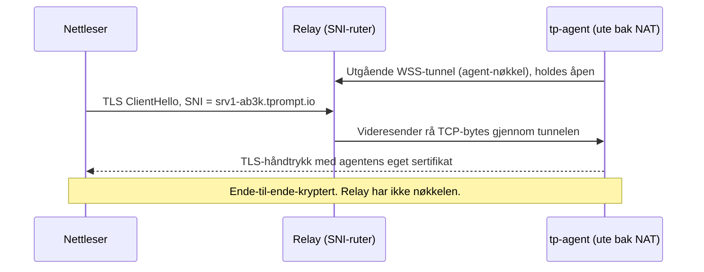

# 17 – Tilkobling og onboarding

Målet: **en bruker uten domene, sertifikat eller nettverkskunnskap skal ha en trygg HTTPS-tilkobling til serveren sin på under 2 minutter, og vite at alt virker før hen drar på sjøen.**

Dette er den viktigste funksjonen for å få betalende brukere. Uten den stopper de fleste ved «sett opp domene og sertifikat».

## Tre tilkoblingsruter

| Rute | Hvordan | Krever av brukeren | Pris | Versjon |
|---|---|---|---|---|
| **1. Relay** (anbefalt) | Agenten kobler seg *ut* til relay. Brukeren får en ferdig HTTPS-adresse, f.eks. `srv1-ab3k.tprompt.io` | Én kommando på serveren | Personal / reisepass | **v1.5** |
| **2. Eget domene** | Installasjonen setter opp Caddy + Let's Encrypt automatisk | Domene med DNS-oppføring mot serveren | Gratis | v1 |
| **3. Lokalt** | Kun `127.0.0.1` / SSH-tunnel | Teknisk kunnskap | Gratis | v1 |

`tprompt.io` er en plassholder. Endelig domene må kjøpes og sjekkes for ledighet før M7.

## Rute 1: Relay med TLS-gjennomstrømming (v1.5)

### Prinsipp: relay kan ikke lese trafikken

Relay terminerer **ikke** TLS for agentenes adresser. Den ruter krypterte TCP-strømmer videre basert på SNI (vertsnavnet i TLS-håndtrykket). TLS går helt fra nettleseren til agenten. Relay ser bare kryptert trafikk og metadata (tid, datamengde).



### Sertifikater uten at relay får privatnøkkelen

1. Agenten lager et nøkkelpar (P-256) lokalt. Privatnøkkelen forlater aldri serveren.
2. Agenten sender en CSR (sertifikatforespørsel) for `srv1-ab3k.tprompt.io` til relay.
3. Relay løser ACME DNS-01-utfordringen (relay eier DNS for `tprompt.io`) og får sertifikatet utstedt for agentens CSR.
4. Relay sender sertifikatet til agenten. Agenten bruker det i sin `SecurityContext`.
5. Fornyelse automatisk hver 60. dag på samme måte.

**Rate limits:** Let's Encrypt begrenser antall sertifikater per registrert domene per uke. Løsning: søk om å få `tprompt.io` på Public Suffix List, slik at hvert underdomene regnes som eget domene. Reserveløsning: en ekstra ACME-utsteder (ZeroSSL eller Google Trust Services).

### Agent-tunnel

- Utgående WSS til `relay.tprompt.io:443`. Ser ut som vanlig HTTPS-trafikk og virker gjennom skips- og bedriftsbrannmurer.
- Autentisering med agent-nøkkel (ed25519) registrert ved linking.
- Multipleksing: én tunnel bærer mange TCP-strømmer (enkel rammeprotokoll: `stream_open`, `stream_data`, `stream_close`, `ping`). Spesifiseres i doc 04 ved M7.
- Gjenoppkobling med backoff. Under kort brudd i tunnelen merker nettleseren et kort hikk, og sesjonsgjenopptaket (doc 04) tar resten.

### Linking (koble server til konto)

```
Telefon/PC: logg inn på tprompt.io → «Legg til server» → viser kode: TPLK-4F7Q-9X2M
Server:     tp-agent link TPLK-4F7Q-9X2M
```

- Koden består bare av store bokstaver, siffer og bindestrek, og varer 15 minutter. Kan skrives selv i en VNC-konsoll med feil tastatur (`-` sjekkes i kalibrering; ellers tilbys versjon uten bindestrek).
- Agenten lager agent-nøkkel og TLS-nøkkel, registrerer seg, henter sertifikat og starter tunnelen.
- Appen viser «✓ srv1 er online» i sanntid.

### Relay-arkitektur (v1.5)

| Del | Teknologi |
|---|---|
| Konto, innlogging, dashbord, betaling | Dart-server bak Caddy, Postgres, Stripe |
| SNI-ruter | Dart `ServerSocket` på 443; leser ClientHello, ruter på SNI, ingen TLS-terminering for agent-domener |
| Eget dashbord (`tprompt.io`) | Vanlig TLS terminert av Caddy |
| DNS | Wildcard `*.tprompt.io` → relay-IP; DNS-01 via DNS-leverandørens API |
| Hosting | EU (Hetzner), én server i v1.5; to servere bak DNS-failover i v2 |

## Rute 2: Eget domene, automatisk HTTPS

Installasjonen (`install.sh --domain tp.example.com`):

1. Sjekker at domenet peker til serverens offentlige IP (`getent hosts` + ekstern IP via `https://`-oppslag). Stopper med tydelig forklaring hvis ikke.
2. Sjekker om port 80/443 er ledig eller allerede brukes av Traefik/Coolify, nginx eller Caddy (doc 06).
3. Ingen webserver: installerer Caddy, skriver `Caddyfile` og starter. Caddy henter og fornyer sertifikatet selv.
4. Eksisterende webserver: viser ferdig konfigurasjonssnutt og spør før den skrives.
5. Tester `https://tp.example.com/healthz` utenfra før den melder suksess.

## Tilkoblingsveiviser i appen

```
[Koble til server]
  1. Hvor er serveren?      ○ Jeg har ikke domene (anbefalt: relay)
                            ○ Jeg har eget domene
  2. Kjør denne kommandoen  ┌─────────────────────────────────────┐
     på serveren:           │ curl -fsSL https://get.tprompt.io | sh -s -- --link TPLK-4F7Q-9X2M │ [Kopier]
                            └─────────────────────────────────────┘
                            Har du bare VNC-konsoll? → [Hjelp med VNC] (doc 08)
  3. Venter på serveren …   ✓ srv1 er online
  4. Sikre tilgangen        [Registrer passkey på denne enheten]
                            [Lag reservekoder]
  5. Ferdig                 [Kjør sjekk før avreise]
```

## Reservekoder

Mister brukeren telefonen på sjøen, kan passkeyen være borte. Reservekoder er da eneste vei inn.

- 10 engangskoder, 10 tegn hver, i grupper på 5 (`7KQ2M-X9PLA`), uten lett forvekslede tegn (0/O, 1/I/L).
- Lagres som argon2id-hasher i agenten (selvhostet) og i relay-kontoen (relay).
- Hver kode virker én gang og erstatter både passord og passkey. Etter bruk varsles brukeren og oppfordres til å registrere ny passkey.
- Vises én gang ved generering, med [Last ned som tekstfil] og [Skriv ut].
- Ny generering gjør alle gamle koder ugyldige.
- Advarsel i appen hvis færre enn 3 koder er igjen.
- Kreves som del av «Sjekk før avreise».

Legges til doc 05 (sikkerhet) og M5 (innlogging).

## Sjekk før avreise

Én knapp i appen. Kjører alle tester og viser grønt «Klar til avreise» eller en liste over hva som mangler, med en «Fiks»-knapp per punkt.

| Kontroll | Hvordan | Fiks |
|---|---|---|
| Serveren svarer | `/healthz` via valgt rute | Viser feilsøking |
| Innlogging virker | Gyldig sesjon | Logg inn |
| Passkey på denne enheten | WebAuthn-liste | Registrer |
| Reservekoder finnes (≥ 3) | Telling | Lag nye |
| Appen er installert (PWA) | `display-mode: standalone` | Viser installasjonsguide for iOS/Android |
| Fungerer uten WebSocket | Tvungen SSE-test | Melder feil i proxy-oppsett (`proxy_buffering off`) |
| Sesjonsgjenopptak | Kobler fra og til, sjekker seq | – |
| Agent-versjon er oppdatert | Sammenligner med siste release | [Oppdater] |
| Sertifikat gyldig > 14 dager | Leser utløp | Tvinger fornyelse |
| tmux-modus på (anbefalt) | Config | Slår på |

Resultatet kan lagres som «sist sjekket: 14.11. kl. 21:40 ✓».

## Prising (oppdatert)

| Plan | Pris | Innhold |
|---|---|---|
| Self-host | Gratis | Rute 2 og 3, én eller flere servere, alle v1-funksjoner |
| **Reisepass** | USD 9 for 30 dager, uten abonnement | Relay for inntil 3 servere i 30 dager. For cruise, reiser og korte oppdrag |
| **Personal** | USD 9/mnd eller 90/år | Relay for inntil 5 servere, egne knapper synket mellom enheter |
| Pro / Fleet | Se doc 09 | Kommer i v2 |
| **Founder-lisens** (før v1.5) | USD 99 engangs = 3 år Personal | Selges på venteliste for å teste etterspørselen |

## Målgrupper som rute 1 åpner for

Alle på **restriktive nett** der bare vanlig HTTPS virker stabilt:

- skip og rigger
- cruiseskip (VPN ofte blokkert på enklere wifi-pakker)
- fly, hotell, tog, flyplass og konferanse-wifi
- bedriftsnett

Markedsføres som «nå serveren din fra hvor som helst». Ikke markedsført som verktøy for å komme rundt statlig sensur.

## Akseptansekriterier (M7, v1.5)

- Fra «Legg til server» til «✓ online» på en ny Hetzner-server uten domene: < 2 minutter.
- Pakkefangst på relay viser bare TLS-kryptert trafikk mellom nettleser og agent.
- Agentens TLS-privatnøkkel finnes aldri på relay (verifisert ved kodegjennomgang og test).
- Reisepass utløper automatisk og agent-adressen slutter å svare. Fornyelse gjenoppretter samme adresse.
- «Sjekk før avreise» oppdager hvert av punktene i tabellen når de er feil.
